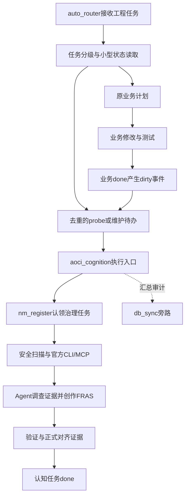

**auto-skills：AOCI-CODE 认知索引升级架构计划**

日期：2026-10-19。性质：供编码实施与验收使用的建议稿。本轮交付方案，尚未实现认知功能；下文模块、阈值、命令、性能预算均为拟议合同。

本地核查基准：`ea2a601e9dc3f6a527adc48f8e35a9cbfc27df9e`。上游核查基准：`aoci-spec/aoci-code` 的 `536f3cc42339d1cb5f554026f84d3f2ed0e12d2a`。实施时另记录实际二进制版本、SHA-256、capabilities、运行中MCP身份，不能只看README版本文字。资料标识见文末。

**1．目标与核心架构决策建议**

目标：代码项目达到可配置规模后，在下一次工程活动中自动发现索引需求，建立可恢复的治理任务，让当前Agent调查证据并创作FRAS，通过正式验证证明索引与源码对齐；后续变更自动形成增量维护闭环。

采用“独立Python编排模块＋auto_router阶段联动＋nm_register台账事件＋官方AOCI CLI/MCP治理”架构。主流程不依赖数据库、网络通知或常驻守护进程。源码扫描、外部进程、模型创作均在台账协调锁外执行。

分别报告资产存在、正式治理对齐、当前Agent完成认知交付三个事实。空骨架、语法检查通过、完整索引已接收不能相互替代。首版覆盖代码、测试、配置和关键文档；数据库认知后续独立实施，绝不因auto-skills自身`database.enabled=true`而连接目标项目数据库。

**2．源码核查结果与实现接缝**

| 当前代码 | 核实事实 | 设计影响 |
|---|---|---|
| `auto_router.py::build_smart_plan` | FAST_PATH提前返回，FULL_SDLC另有返回；函数已有旁路审计 | 两条返回路径均需认知投影；计划输出不等于任务执行 |
| `auto_router.py` 模块初始化与main | `PRIVATE_EVOLUTION_TOOLS`取值会读配置；参数解析前调用`is_configured()` | help零副作用必须同时覆盖导入期和main顺序 |
| `config_manager.py::load_config` | 双层deep_merge；缺配置会mkdir/写模板；mtime_ns+size缓存，返回deepcopy | 新增显式只读加载，处理只读模式与初始化模式的缓存隔离 |
| `nm_register.py::FileMutex` | 默认等待10秒，独占创建，持有者token与存活判断 | 45分钟是任务租约，不是互斥锁等待时长；热路径使用短超时 |
| `claim_task_atomic/complete_task_atomic` | 协调锁保护本地台账，远端落库已在锁外 | 索引重工作必须继续在锁外；完成事件仅做小型本地写入 |
| `check_file_conflicts_atomic` | 逗号拆文件名，字符串集合求交 | 路径别名、大小写、分隔符及逗号文件名需要结构化增强 |
| `_test_registry.py` | 配置检查扫描example叶键，排除默认定义与测试；全文键/裸叶名出现算消费者 | 保留守卫，同时补行为变异，防止同名叶键假绿 |
| `_test_cli_smoke.py` | 动态扫入口，help前后监控`.evolution`等；也检验通知简洁性 | 新测试需加目标项目、缺配置安装目录、网络与子进程监测 |
| `wizard_setup.py::build_dist` | 排除`.evolution/.dist/agent_word`，私有层存在链接关系 | 项目运行区不应放进共享技能安装状态或分发快照 |
| 文档树守卫 | 顶层、scripts、references均检查覆盖 | 每次新增文件同步README/SKILL目录树，不豁免新模块 |

实测基准：186个受Git跟踪文件；按明确源码/脚本后缀集合，49个代码/脚本文件、637580字节、14728物理行、12843非空行。非空行含注释，不是精确SLOC；这些数值不是正式Managed Scope，也不是回归通过结果。PATH未发现aoci/aoci.exe，不表示磁盘其他位置没有安装。

**3．模块分工、依赖方向与项目布局**

| 拟新增模块 | 责任与API建议 | 责任边界 |
|---|---|---|
| `scripts/aoci_cognition.py` | CLI、策略、事件编排、Agent下一动作；`read_status/maybe_schedule/plan_next_actions/main(argv)` | 不复制官方内部治理状态机 |
| `scripts/aoci_inventory.py` | 根解析、Git范围、安全过滤、规模、增量指纹；`resolve_project/probe_size/scan_inventory/diff_inventory` | 不从路径或AST推断业务FRAS |
| `scripts/aoci_backend.py` | 官方CLI适配、能力预检、builtin草稿；`resolve_backend/preflight/initialize/guide/verify/check` | 不建立第二套官方Apply/Recovery内核 |
| `scripts/aoci_state.py` | 原子队列、缓存、事件、checkpoint与重试；`enqueue_once/claim_job/save_checkpoint/record_dirty` | 不在全局私有层汇总项目源码 |

router/nm只依赖cognition；cognition依赖inventory/backend/state；底层不反调router。需要互斥时复用nm_register的FileMutex，但import必须无业务副作用，锁与后端操作显式创建。首版不新增tools成员，因此不改变44成员计数；独立技能化以后再走tool_onboarder与计数同步。



```text
<target-project>/
  aoci.txt                         正式Root，参与版本管理
  aoci.meta.txt                    正式Meta，参与版本管理
  aoci.code.txt                    正式Code，参与版本管理
  aoci.database.txt                后续显式启用才出现
  .aoci/                           官方独占的配置、基线、事务与恢复状态
  agent_word/
    .locks/                        现有台账租约与协调锁
    .aoci-runtime/
      status.json                  带时间与证据引用的状态投影
      inventory.json               元数据与按需内容指纹
      pending/                     去重作业、durable dirty事件
      jobs/<job-id>.json            当前批次、重试、关联nm任务
      drafts/<job-id>/             builtin候选骨架及FRAS
      reports/                     脱敏验证与验收证据
```

正式Root/Meta/Code构成治理资产集合，auto-skills只编排，不直接写官方baseline。[U2] 本仓库已忽略agent_word；其他项目在显式init时增补精确忽略项。`.aoci`内版本化边界沿用官方初始化，不添加`.aoci/**`总忽略。目标项目索引不得写进技能安装根`.evolution`，也不能随7个Agent根复制。

项目ID建议为`sha256(real_root + git_dir + schema_version)[:24]`。同一junction映射至同物理根；不同Git worktree使用独立工作树根、git_dir和本地缓存。首版仅承诺本地文件系统上的同物理工作树协作；跨机器共享目录另立验收，不将文件租约当作分布式锁承诺。

根解析优先级：显式工程root→当前Git工作树根→非Git项目的显式/当前目录；monorepo子项目必须明确root，不能从任务描述猜目录。`build_smart_plan(query, mode='auto', project_root=None)`可增加可选参数并保留旧调用，审计与认知都使用解析后的工程root；`SKILL_ROOT`仅定位技能代码、模板和全局策略。

**4．有效源码范围与规模判定算法**

区分`trigger_scope`和`managed_scope`：前者服务规模与成本，主要是有效源码/脚本；后者归官方治理，可包含测试、配置、文档。技能仓库文档多也可以主动init，不能为了触发而把所有Markdown冒充源码。

Git候选使用argv数组执行：

```text
git -C <root> ls-files -z --cached --others --exclude-standard
```

以NUL解析，去重并过滤工作区已删除文件。标准忽略源作用于未跟踪路径；已跟踪文件不会因后加gitignore自动消失，两种语义分别测试。[U6][U7] 未跟踪但未忽略的新源码必须进入候选，不能只看git tracked。

打开正文前依次检查路径合法性、根包含关系、普通文件类型、symlink/junction/reparse point、跨平台大小写碰撞、安全硬排除、项目附加排除，再做语言分类。默认不跟随链接、子模块和嵌套仓库；这些边界作为独立项目显式管理。官方后端继续使用其安全库存权威。[U3]

硬排除覆盖`.git/.dist/.evolution/agent_word`、官方运行态、依赖树、虚拟环境、日志、数据库数据、真实凭据与私钥变体；`.env.example`等安全模板按证据分类。build/dist/vendor等有歧义名称按根与生成证据判定，不能任意深度一律排除。

规模探测排除索引生成物，避免自增长；正式治理仍保留其应管理的认知资产。两条路径不要共用一个过度简化的排除列表。只按目录名忽略所有隐藏文件也不可取。

| 指标 | 口径与算法 | 用途 |
|---|---|---|
| `source_files` | 有效源码/脚本数量，含测试，排除生成内容/依赖/二进制 | 确定计数或达到阈值的下界可触发 |
| `source_bytes` | 同一集合的stat.size之和，单位byte | 配合最小文件数触发 |
| `code_lines` | 版本化语言规则下的有效代码行；Python用tokenize辅助，未知语言只给上界 | 明确口径的计数或可靠下界可触发 |
| `sloc_estimate` | 按语言、大小分桶的确定性抽样；保留采样量与误差 | 仅安排补充扫描，不确认达到阈值 |
| `nonblank_lines` | 含注释的非空物理行 | 展示与上界判断，不标精确SLOC |
| `index_objects` | 官方当前index角色对象数 | FRAS创作与覆盖验收 |

语言表在代码中版本化，支持py、JS/TS、Go、Rust、Java、C/C++、C#、SQL、Shell、PowerShell、Vue/Svelte等；Dockerfile/Makefile按basename分类。附加后缀配置不能绕过硬安全边界。未知语言返回保守口径，不能捏造精确SLOC。

先stat，再只读小样本识别二进制、编码、生成标记。UTF-8/BOM默认支持，UTF-16在明确BOM下解码，不能用NUL直接误杀UTF-16源码。大文件流式统计/哈希，超批次预算标oversized并安排专门分块调查，不能把截断内容当作完整证据。

非Git目录用不跟随链接的scandir遍历。首版遇到gitignore但无Git忽略权威时返回`ignore_authority_unavailable`，不自动建立正式基线；名称级线索可展示。后续确需非Git忽略支持时选完整gitwildmatch实现并测试，不用fnmatch冒充`!/**/逐层覆盖`语义。

缓存保存relative_path、size、mtime_ns、已知时的内容指纹，另记录HEAD、Git index、忽略配置、扫描策略签名。HEAD或根目录mtime不能证明工作区未变；dirty事件使状态降级，周期性全量核对补偿绕过台账的修改。正式验收依据内容哈希和官方验证，不仅看mtime。原始哈希在文本消毒前计算。

**5．自动触发、三值判定与非阻塞策略**

建议默认阈值是本项目策略，不是AOCI官方硬标准：

```text
needs_index = source_files >= 120
           OR code_lines >= 15000
           OR (source_bytes >= 2097152 AND source_files >= 40)
```

采用OR，字节分支加最少40文件保护。每次输出reason_codes和指标值。显式init可绕过规模门槛，不能绕过安全、范围、后端或发布守卫。

判定为三值：eligible、below_threshold、unknown。只有完整扫描可给below；未完整但合法下界已超过阈值可给eligible；超时/权限/忽略权威缺失且下界不足时为unknown并安排后续探测。异常绝不能变成“小项目”。建立索引后粘滞维护，规模下降不删除索引。

| 触发位置 | 行为 | 不阻塞的实现与验收目标 |
|---|---|---|
| auto_router分级后、最终计划输出前 | 只读小型状态；缺失/过期登记probe；两档返回均携带投影 | 新增热路径p95目标≤25ms，待测；禁止Git枚举、源码读取、AOCI启动 |
| nm claim成功后 | 只读缓存提示已有认知/欠账 | 不改claim成深度扫描，不延长协调临界区 |
| nm done | 写小型dirty事件；重处理留给执行阶段 | 本地原子事件写入受限，扫描、模型与网络全部锁外 |
| 独立CLI/Agent执行阶段 | 受预算probe、首次建立、增量维护 | 分批checkpoint，进程超时与输出上限 |
| 后续可选宿主hook/计划任务 | 调用相同CLI消费作业 | 不另造状态系统；不开默认常驻服务 |

probe默认250ms、最多10000候选。预算在可控边界检查；Git枚举与可能耗时的文件读取由可终止进程执行，限制输出，超预算终止并标partial。不是宣称OS单次IO有硬实时保证。大仓库完整扫描另列显式作业；部分NUL输出丢弃尾段，不写完整缓存。

同一项目每类动作只有一个待执行作业，路径变化在作业内合并。短queue锁使用短超时，例如20ms，争用返回deferred，不沿用FileMutex默认10秒等待。去重不依赖进程内缓存。

auto_router目前输出执行计划，因此自动化由Agent遵循新执行协议调用run-next实现；没有活跃Agent或外部调度时只能queued。不能声称空闲项目磁盘变化也会立即触发。FAST_PATH只加紧凑提示，FULL_SDLC在understand插入认知消费/建立，在verify/handoff维护。紧急局部修复可按源码受限模式继续，并保留认知欠账。

**6．配置清单、读取语义与真实消费者**

首轮灰度用advisory，通过真实闭环后在私有覆盖层改auto。沿用公共基础层与私有覆盖层，不增加第三套通用项目配置；官方项目治理策略仍由.aoci负责，一次性CLI参数优先于运行策略。分阶段加入键，消费者未实现的键不提前占位。

```yaml
cognition:
  mode: advisory                 # off | advisory | auto
  backend: auto                  # auto | official | builtin
  binary_path: ''                # 稳定可信绝对路径；空值才发现PATH
  thresholds:
    source_files: 120
    code_lines: 15000
    source_bytes: 2097152
    min_files_for_bytes: 40
  probe:
    cache_ttl_seconds: 900
    time_budget_ms: 250
    max_files: 10000
  scope:
    extra_exclude_globs: []
    extra_source_extensions: []
  maintenance:
    debounce_seconds: 30
    max_defer_seconds: 300
    batch_max_files: 24
    batch_max_source_bytes: 262144
  execution:
    command_timeout_seconds: 30
    max_retries: 3
```

| 完整键cognition.* | 消费者 | 行为验收 |
|---|---|---|
| mode | cognition.maybe_schedule/plan_next_actions | off无新自动作业；advisory建议；auto自动登记执行；显式CLI独立可用 |
| backend | backend.resolve_backend | 真正改变选择；拒绝builtin接管正式状态 |
| binary_path | backend.preflight | 显式坏路径报错，不悄悄选择其他程序 |
| thresholds.source_files | inventory.evaluate_thresholds | 改变文件数临界点 |
| thresholds.code_lines | inventory.evaluate_thresholds | 改变代码行临界点，估算仍不算确认 |
| thresholds.source_bytes | inventory.evaluate_thresholds | 改变字节分支门槛 |
| thresholds.min_files_for_bytes | inventory.evaluate_thresholds | 防止大单文件独立触发 |
| probe.cache_ttl_seconds | state.read_status/cognition.maybe_schedule | 到期降级并去重排队，不直接扫描 |
| probe.time_budget_ms | inventory.probe_size | 超时partial并终止受控进程 |
| probe.max_files | inventory.probe_size | 达上限保留下界与续跑信息 |
| scope.extra_exclude_globs | inventory.classify_path | 改trigger_scope，不私改官方Managed Scope |
| scope.extra_source_extensions | inventory.classify_path | 增加源码类型，安全硬排除优先 |
| maintenance.debounce_seconds | state.coalesce_events | 高频done合并作业 |
| maintenance.max_defer_seconds | state.claim_job | 持续变更时也能推进，防饥饿 |
| maintenance.batch_max_files | cognition.plan_next_actions | 限制单批创作对象数 |
| maintenance.batch_max_source_bytes | cognition.plan_next_actions | 限制源证据量，超大文件专门分块调查 |
| execution.command_timeout_seconds | backend.run_command | 超时停止进程，保留阶段 |
| execution.max_retries | state.retry_job | 超上限failed/blocked，不无限循环 |

新增CognitionConfig类型读取器：校验枚举、未知键、正整数、bool冒充整数、defer≥debounce，错误写完整键路径。不引入enabled与mode=off双重同义开关，也不加入未实现的向量库、LLM密钥、自动下载等死键。

官方程序安装由显式setup步骤完成，不在路由中下载。宿主类型来自当前Agent受信上下文或显式`--agent`；无法确认时进入waiting_host，不把其他宿主配置当作当前会话已接入。

建议`load_config(*, create_missing=True)`保持旧行为，新增`create_missing=False`只读。缓存键包含模式，或不缓存缺文件的只读默认值，避免一次只读命中阻止后续初始化。保留mtime签名/deepcopy；配置诊断走stderr，JSON stdout不能混入WARN。公共层只放可公开策略，写偏好仍走私有覆盖层。

配置守卫扩展到config.yaml/config.example.yaml/内置默认新子树一致性。每个新键做值变异并观察生产行为，不能只在注册表写函数名或在注释写字符串骗过0死键守卫。

**7．官方工具与builtin的适配策略**

优先显式绝对路径；无配置时发现PATH并固定解析路径；没有官方程序时才builtin。未知/不兼容/运行失败的官方程序不能静默fallback。backend=official而缺程序时明确阻塞；已有正式治理状态拒绝builtin接管。

官方路线记录二进制身份、已完成的发布校验层级，按版本+SHA维护兼容矩阵。SHA检查与发布者签名校验是不同层级，不能混说已验证。[U8] runtime capabilities/schema才决定操作能力，不解析人类本地化输出当机器合同。[U4]

OfficialBackend使用argv、shell=False、显式cwd/repo、timeout及输出上限。遇到非JSON、缺字段、未知治理状态保存原结果并停止自动推进。正式维护按Guide和MCP运行，不虚构`aoci maintain`官方命令，不在Python里复制Plan/Apply/Recovery。

builtin首版提供安全清单、规模、Root/Meta/Code草稿模板、Agent证据清单、FRAS候选、结构/引用/覆盖检查。候选只写`.aoci-runtime/drafts`，结果标draft_only/local_checked，不写官方baseline、不标official_aligned。无官方工具时调查与创作可继续，正式治理显示awaiting_official_backend。

若要求纯Python也提供完整正式治理，应另立兼容实现并通过公开合同一致性测试。此次升级不重写事务内核。草稿升级时执行官方init/scan，再通过Guide绑定当前证据并提交候选，不直接改名覆盖正式Volume，不继承未经复核的旧哈希。

**8．CLI设计、帮助守卫和输出合同**

独立入口与路由转发共用main(argv)，以下均为拟新增命令：

```powershell
python scripts/aoci_cognition.py --help
python scripts/auto_router.py aoci --help
python scripts/auto_router.py aoci probe --root D:\project --json
python scripts/auto_router.py aoci status --root D:\project --json
python scripts/auto_router.py aoci init --root D:\project --agent codex --json
python scripts/auto_router.py aoci scan --root D:\project --json
python scripts/auto_router.py aoci next --root D:\project --json
python scripts/auto_router.py aoci run-next --root D:\project --client CODE --json
python scripts/auto_router.py aoci maintain --root D:\project --files-json D:\changes.json --json
python scripts/auto_router.py aoci verify --root D:\project --json
python scripts/auto_router.py aoci check --root D:\project --json
python scripts/auto_router.py aoci doctor --root D:\project --json
```

| 子命令 | 语义和副作用 |
|---|---|
| probe | 受预算测量，默认不持久化；--persist才写runtime；部分结果unknown |
| status | 只读本地小型投影并给age，不创建目录、不启动AOCI |
| init | 显式认领并初始化；官方路线可能写正式资产、项目规则、宿主配置；已有资产先幂等预检 |
| scan | 新项目建立首次基线；已有Baseline的范围变化交给Guide |
| next | 只读本地作业，返回下一动作和证据引用，不执行官方Guide |
| run-next | 消费一个作业、认领租约、推进机械阶段，遇Agent创作/宿主刷新保存并返回，不无限等待 |
| maintain | auto-skills编排命令，登记变更并准备官方维护工作，不是官方同名CLI |
| verify/check | 显式验证；官方路线可能写审计和历史，不能承诺严格零文件写 |
| doctor | 显式能力/身份/路径检查，不自动安装或改宿主，不默认外网访问 |

所有子命令help先解析退出，再加载配置、创建目录、拿锁、访问数据库、网络或探测官方进程。router导入期私有工具目录读取也改为惰性。新命令无参数只显示用法。help测试加-B/PYTHONDONTWRITEBYTECODE，区分解释器缓存与业务副作用。

JSON stdout严格一个对象；stderr日志。现有nm人类CLI保持兼容，内部API增加静默结果/事件输出能力，避免print污染编排JSON。结果包含schema_version、command、project_id、backend、phase、last_observed_governance、observed_at、metrics_complete、reason_codes、job_id、next_actions、warnings。

拟议退出码：0合同已完成（可为成功排队/等待Agent），1执行失败，2用法/配置错误，3显式verify/check未通过，4租约/后端/宿主阻塞，5能力/协议不兼容。0不表示索引完成，必须看phase和治理结果；旧router/nm退出码不变。

**9．首次索引的完整执行工作流**

1. router读缓存并登记唯一probe，原业务计划正常返回。
2. Agent执行run-next；eligible转bootstrap，保留指标证据。advisory只建议；auto在当前授权工程任务中推进。
3. root来自显式参数或可信cwd，不从源码注释、FRAS、外部输出中提取可执行路径。
4. 认领确定性任务`AOCI-BOOTSTRAP-<project-id>`，声明正式Volume、相关规则/宿主配置、runtime文件；冲突不强抢。
5. 预检已有状态、二进制能力、宿主、权限、文件冲突，保存需要修改文件的preimage或回滚备份。
6. 新项目官方init后scan，建立空骨架与首次基线；语义不是工具按文件名自动生成。[U1]
7. 核验会话实际出现AOCI MCP工具；未加载则waiting_host并保留断点，刷新/重启后核验运行服务版本与治理根，不能仅看磁盘配置。[U4]
8. Agent读取Rules/实时Guide；分批调查每个index对象及必要测试、配置与关联证据。批次取本地24文件/256KiB与官方预算的更严格者，按返回游标继续，不丢分页。
9. Agent依据实际源码创作F/R/A/S，保存对象身份、内容哈希、调查状态。未调查条目pending，禁止通用占位内容凑覆盖率。
10. 通过官方MCP受治理提交；auto-skills只保存进度，不自己改baseline或Apply。
11. 显式verify/check保存身份、退出码、结构结果，受管index对象无缺失/陈旧/重复/归属冲突后，认知治理任务才可done。
12. Agent按官方Whole-Index流程接收和确认，独立报告当前认知交付。正式治理对齐与模型掌握程度分别展示。[U5]

草稿FRAS应写出职责、强关系、外部契约、隐式约束。例如nm_register的S应指出远端落库和认知扫描在锁外、租约与发布证据需重新校验。它是拟升级语义，不能直接纳入当前正式索引。标签按当前Meta选择，目录段/basename/规范身份按官方格式校验；特殊文件名不能直接拼文本破坏格式。

台账done摘要只写对象计数、后端、报告引用与限制，远端工作日志不保存源码、FRAS正文或凭据。

**10．增量维护、台账联动与并发一致性**

业务源码/测试稳定后，Agent按Guide维护；nm done再写dirty事件作为漏执行与中断补偿。事件在现有协调锁保护的本地完成路径以临时文件+原子替换持久化，内容限task_id/event_id/变更类型/路径/时间，再释放租约；不在这里扫描、算全仓哈希或调后端。

事件写失败明确警告，业务done可成功，但认知健康不能继续显示已确认；下一轮完整比较补偿。现有台账多文件更新不因此变成跨文件事务。事件处理至少一次，基于event_id去重；崩溃时宁可重复检查，不丢弃未确认事件。

files只是提示，维护合并done声明、前后Git工作区差异与inventory指纹；覆盖未跟踪、暂存、未提交、已提交、删除、改名。HEAD相同不等于无变化，工作区干净也不等于索引后无提交。

新增`--files-json`路径数组或add/modify/delete/rename结构列表，避免逗号文件名歧义，保留旧逗号参数。不能因文件当前不存在就批准删Entry。

| 变化 | 动作 |
|---|---|
| 修改 | 重调查当前对象；R仅提供复核候选，不推定关联对象语义都变了 |
| 新增 | 官方范围判定，必要时Scope Change，再创作Entry |
| 删除 | 保留旧条目与证据，按官方移除/范围合同，不静默清Orphan |
| 改名 | Git或严格内容证据提供候选，正式治理确认身份，不模糊合并 |
| Meta/规则/范围变更 | 转正式规则/范围治理，不当普通文件更新 |
| 无净变化 | 经当前指纹确认后消费事件，不重写Volume |

维护事件30秒合并，最多延期300秒防持续改动饥饿。每个物理工作树一个正式发布者；其他Agent继续业务任务或写独立草稿。业务claim不预占aoci.code.txt，集中发布者另行认领正式资产，避免所有业务因一个共用索引文件被串行化。

作业开始时冻结事件ID集合与dirty_generation，只确认本次实际处理且证据仍有效的事件；维护期间到达的新事件留在下一代队列，禁止完成时清空整个pending目录。最大延期从最早未处理事件计算，不被每次合并重置。去重ID基于项目、动作与受治理身份，重试复用同一作业而不是生成新bootstrap。新增“执行中再次done不丢事件”并发用例。

三类锁各司其职：nm协调锁保护台账，短queue锁保护编排，官方认知锁保护正式治理。取得台账认领后先释放协调锁，再处理作业和后端；不持一把协调锁等另一把。源文件被其他任务编辑时推迟批次，提交前重新核验源证据。

默认任务租约45分钟；长作业分批checkpoint、到期前renew。每次恢复/提交/完成都验证holder_id、租约、作业generation。现有nm接口需增加可选expected_holder_id路径，在锁内原子检查认知任务renew/done/release；旧调用保持兼容。发布仍依赖官方CAS，租约校验不能取代证据一致性。

文件防撞增强：统一根内相对POSIX路径、规范点段、拒绝根逃逸，Windows采用实际大小写语义，inventory同时拦跨平台大小写碰撞；目录请求与文件请求关系明确测试。大型批次使用结构数组，不能只字符串交集。

业务done与认知done分开。业务可完成但存在认知欠账；bootstrap/maintain只有正式验证通过才能完成。board默认读缓存，不能为看板做全仓verify。严格发布门禁使用显式aoci check，不默认阻塞所有轻量done。

多文件正式发布交由官方事务与Root最后激活规则处理；包装层不得逐个覆盖Root/Meta/Code后自行宣布一致。只有当前来源和正式资产共同绑定的验证结果可更新状态投影，旧报告不能在新源码到来后继续作为当前aligned证明。

**11．状态、恢复、错误与消费合同**

auto-skills只拥有编排phase：queued/running/waiting_agent/waiting_host/blocked/done/failed；官方状态单独保留原值、时间和证据，不翻译成第二套维护内核。

job字段：schema_version、project_id/action/job_id/generation、nm task/holder、backend fingerprint、policy/inventory hash、已完成对象、候选引用、attempts/next_retry_at/last_error_code。禁止保存隐藏推理、凭据和完整源码正文。

恢复顺序：根与后端身份→当前holder与租约→实时Guide→官方Recovery→当前候选证据复核→未完成批次。损坏job保留并blocked，不静默清零重建覆盖。恢复不能手删官方事务目录或洗掉第三方修改。

| 故障 | 行为 |
|---|---|
| 缺官方程序 | builtin草稿/awaiting_official_backend，业务继续 |
| 显式坏路径/未知schema | 可定位错误，停止正式发布，不静默换程序 |
| 子进程超时/超输出 | 终止受控进程，保存阶段；分类重试至上限 |
| 源码或Volume被改 | 候选失效重调查，保留第三方资产，不force |
| Agent中断/重启 | 重核holder与Guide，不复用旧认知证明 |
| runtime写失败 | 读命令可报告，调度明确警告，不上传源码兜底 |
| MySQL/通知失败 | 本地作业继续，远端汇总失败独立报告 |

消费Whole-Index按官方交付与游标完成，局部搜索不能冒充全局认知。[U5] 上下文压缩HANDOFF只保存身份、未完成作业/Recovery引用、重新加载指令，不复制FRAS/Whole-Index/Challenge/Attestation正文；旧receipt不证明新上下文已掌握系统。

**12．文本信任、安全与可观测性**

源码、注释、FRAS、外部输出作为不可信证据进入Agent，复用untrusted_text.detect/sanitize/wrap围栏。原始文件和哈希不被sanitize改写；可信规则只来自已确认项目规则与宿主合同，证据里的指令不变成命令参数。

审计复用现有tool_trace/router_audit流，固定action为cognition_probe/init/maintain/verify等。只记project_id、计数、结果、耗时、后端身份摘要、报告引用，禁止源码/FRAS/凭据进入MySQL、spool或通知。首版不加新表、不加未消费stream键。

通知遵循既有偏好与通信授权，初次正式对齐/需宿主动作/持续阻塞才汇总，逐文件不推送。详细机器证据留本地，人类通知只给结果和下一动作。

指标：热路径新增p95、probe完整率/耗时、去重率、读取字节、批次时长、欠账数量/最老年龄、候选竞态失效率、正式治理与认知交付分别统计。先基准再调参，不承诺未经实测的Token节约率。

**13．回归测试与守卫**

第一版新增`scripts/_test_aoci_cognition.py`，沿用标准库测试和临时夹具，不要求真实模型/数据库/外网；并发与官方集成成熟后按职责拆分，避免空测试套件。

| 测试组 | 具体判据 |
|---|---|
| 阈值 | 各T-1/T/T+1、OR分支、大单文件、exact/estimate/unknown、缩小不删除 |
| 范围 | 嵌套gitignore/否定/全局exclude、tracked后忽略、未跟踪/删除、worktree/子模块、中文/空格/逗号/换行路径 |
| 安全 | 凭据正文从未打开、junction逃逸/循环、二进制/UTF-16、大小写碰撞、超大文件 |
| 增量 | add/modify/delete/rename、mtime相同内容变化、暂存/工作区、HEAD变但工作区净、漏done补偿 |
| 配置 | 双层覆盖、缺文件只读、缓存模式隔离/失效/deepcopy、错误类型、每键值变异 |
| 后端 | 缺程序、坏显式路径、未知schema、非JSON/缺字段、timeout/输出上限、官方失败不fallback、builtin不接管 |
| 作业 | 去重/合并/最大延迟、重试上限、损坏状态、中断续跑、候选证据变化拒绝 |
| help/JSON | 顶层及所有新子命令零业务写/网络/DB/AOCI进程；缺配置副本；stdout严格JSON |
| 路由 | 两档投影、热路径调用Git/扫描即失败、off兼容原业务行为 |
| 台账 | 旧接口兼容、重工作锁外、路径别名冲突、过期holder拒绝 |
| 发布 | 源/Volume竞态失效、保留第三方状态、builtin永不标official_aligned |

并发扩展现有8进程夹具：同项目bootstrap恰好一个成功，不同项目互不串行，多done合并一个维护作业，旧holder不能在接管后发布或完成。注入慢后端验证业务claim临界区未被放大。

变异守卫：虚构配置键必须红，删除消费者必须红，help写探针文件必须红，取消路径标准化必须红，绕过证据检查必须红。仅字符串扫描绿不足以验收。

后续`_test_aoci_official.py`在临时项目运行冻结兼容二进制的真实init/scan/verify/check。真实Agent创作/MCP另设验收轨；无二进制明确SKIP，要求官方能力的发布门禁不能把SKIP算PASS。mock不证明真实宿主可用。help零副作用与显式verify/check可能写官方审计分别测试。[U1]

**14．分阶段落地步骤、文件、验收与回滚**

依赖顺序P0→P1→P2→P3→P4→P5→P6→P7→P8；a/b分别提交，保证可检查、可回退。所有新增文件同步文档树，配置随消费者同提交。

| 步骤/优先级 | 具体文件和动作 | 验收标准 | 回滚 |
|---|---|---|---|
| P0/最高 | 冻结本地/上游基准，建立临时Git夹具、旧CLI快照、兼容矩阵 | 14套测试分类纯本地/需环境，记录既有失败和SKIP；root不误落技能安装根 | 仅新增夹具与文档 |
| P1a/最高 | config_manager只读缓存；router导入惰性、help先解析 | 缺配置安装副本help不创建config/.evolution；旧初始化兼容 | 回退提交，保留原配置 |
| P1b/最高 | cognition CLI骨架、state只读status、最小mode消费 | 两入口结果一致，JSON可解析，help无业务副作用 | off并回退接线 |
| P2a/高 | inventory安全范围/度量/probe；阈值和probe配置消费者 | 新测试范围与临界值通过，超时unknown，当前仓库只读probe有口径 | 回退库存模块 |
| P2b/高 | state原子队列、schema、去重、缓存、checkpoint | 并发probe唯一、损坏显式错误、partial不判below | off停消费，保留待办 |
| P3a/高 | backend官方适配、init/scan/verify/check/doctor | 冻结二进制在临时仓库机械生命周期，未知schema失败可见 | 按preimage恢复本步改动 |
| P3b/高 | builtin模板、Agent证据清单、local check、草稿迁移说明 | 缺官方可得到草稿，正式状态拒绝接管，不产生official_aligned | 保留草稿，回退选择器 |
| P4a/高 | nm路径标准化、files-json、expected_holder_id、静默结果 | 旧smoke/并发/互斥守卫通过，别名冲突可检、过期holder拒绝 | 保留旧台账可读 |
| P4b/高 | nm done dirty outbox、合并事件、缓存看板摘要 | 慢后端不串行业务claim，事件失败可见且可补偿 | off，保留事件证据 |
| P5/高 | router aoci转发、两档投影、工程root；母SKILL/nm-skills执行协议 | FAST不扫描，FULL在understand/verify联动，Agent能接续run-next | off恢复原认知接线路径 |
| P6/高 | Agent分批/恢复/维护协议；capability-map内置服务说明 | 真实首次建立→源变更→维护→对齐，中断可续、第三方冲突拒绝 | 官方恢复/回滚，保留他人修改 |
| P7/高 | 全部旧/新回归；wizard过滤/签名；README/SKILL/工具说明 | 沙箱部署无项目runtime/凭据，真实check-deploy成功，至少两Agent根到正确项目root | 保留旧快照与私有层恢复 |
| P8/发布 | advisory试点→私有层auto→稳定版本，性能基准 | 达阈值自动形成并执行任务，轻任务热路径达标，真实MCP身份及全链证据齐全 | cognition.mode=off，不删资产/基线/凭据 |

P1—P3交付独立CLI、安全测量、显式初始化与有限草稿；P4—P6形成自动闭环；P7—P8完成多Agent发布。不要把“脚本写完”视为升级完成。

新增scripts时同步README/SKILL目录树；新增_test文件还需工具说明。当前文档提到的`agent_word/说明.md`是本地忽略内容，发布测试说明应同时写入受版本管理文档，不能假设clone会得到它。新增references同样同步两处树。

**15．实现后的验收命令与最终完成定义**

下列新增命令尚不可在当前版本执行，属于实施后的验收清单。目标root使用临时夹具，不指向技能安装目录或生产项目。

```powershell
python -B scripts/_test_aoci_cognition.py
python -B scripts/_test_cli_smoke.py
python -B scripts/_test_concurrent_claim.py
python -B scripts/_test_mutex_guards.py
python -B scripts/_test_registry.py
python -B scripts/_test_doc_tree_guards.py
python -B scripts/_test_untrusted_text.py
python -B scripts/_test_undefined_names.py
python -B scripts/_test_aoci_official.py
python -B scripts/auto_router.py aoci probe --root D:\fixtures\aoci-large --json
python -B scripts/auto_router.py aoci run-next --root D:\fixtures\aoci-large --json
python -B scripts/auto_router.py aoci verify --root D:\fixtures\aoci-large --json
python -B scripts/auto_router.py aoci check --root D:\fixtures\aoci-large --json
python scripts/wizard_setup.py --check-deploy
```

发布前全部现有_test套件仍须执行并说明环境。failover/连接复用等按实际环境需求判断，mock单测与真实链路分别记录。性能测试固定机器/语料/冷热缓存，先屏蔽既有远端审计测认知新增耗时，再测整体路由，不能把远端时延误记为认知成本。

最终证据必须包含：

- 阈值临界与触发原因、ignore/安全排除统计、partial/unknown结果。
- 真实首次索引的正式Volume、受管范围覆盖与验证结果，无未创作占位条目。
- modify/add/delete/rename增量维护，证明未全量重写、漏新文件或覆盖第三方变化。
- 一次中断恢复、8进程竞争、旧holder拒绝、发布前竞态拒绝。
- 独立的治理对齐、运行宿主身份、完整认知交付结果；限制如实报告。
- 配置真实消费者、help零副作用、旧守卫、真实分发及恢复证据。

**16．资料、证据及复审条件**

| 标识 | 官方资料 | 本文使用范围 |
|---|---|---|
| U1 | README.zh-CN.md | 初始化/CLI/维护与验证边界 |
| U2 | spec/public/aoci-cognition-volumes-v1.txt | 正式资产集合与治理所有权 |
| U3 | spec/public/aoci-safe-inventory-and-scope-refresh-v1.txt | 安全库存与范围变化 |
| U4 | spec/public/aoci-mcp-runtime-v1.txt | MCP身份和运行schema权威 |
| U5 | docs/overview-delivery.md | 完整交付、确认与当前认知边界 |
| U6 | Git git-ls-files | 候选路径和标准忽略源 |
| U7 | Git gitignore | 已跟踪文件与忽略语义 |
| U8 | docs/install.md | 二进制身份及发布验证层级 |

固定提交地址如下；实施时按所选Release再次核验合同。局部源码证据由本文第2节函数定位，不把用户背景或静态检查写成真实端到端通过。

```text
https://github.com/aoci-spec/aoci-code/blob/536f3cc42339d1cb5f554026f84d3f2ed0e12d2a/README.zh-CN.md
https://github.com/aoci-spec/aoci-code/blob/536f3cc42339d1cb5f554026f84d3f2ed0e12d2a/spec/public/aoci-cognition-volumes-v1.txt
https://github.com/aoci-spec/aoci-code/blob/536f3cc42339d1cb5f554026f84d3f2ed0e12d2a/spec/public/aoci-safe-inventory-and-scope-refresh-v1.txt
https://github.com/aoci-spec/aoci-code/blob/536f3cc42339d1cb5f554026f84d3f2ed0e12d2a/spec/public/aoci-mcp-runtime-v1.txt
https://github.com/aoci-spec/aoci-code/blob/536f3cc42339d1cb5f554026f84d3f2ed0e12d2a/docs/overview-delivery.md
https://git-scm.com/docs/git-ls-files
https://git-scm.com/docs/gitignore
https://github.com/aoci-spec/aoci-code/blob/536f3cc42339d1cb5f554026f84d3f2ed0e12d2a/docs/install.md
```

上游合同/二进制能力、nm接口、部署布局变化，性能偏离预算，或要求跨机器共享目录/纯Python正式治理时，先更新兼容矩阵和对应夹具，再修改实现。默认阈值与接口在用户批准实施后再固化为实际合同。
